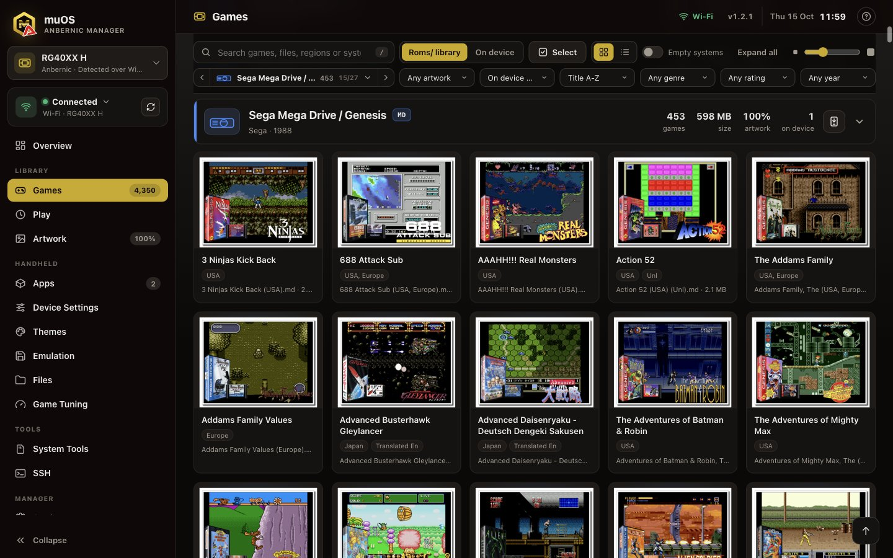
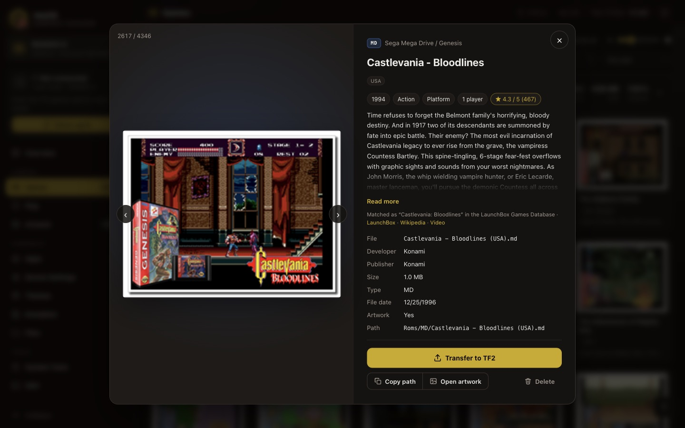
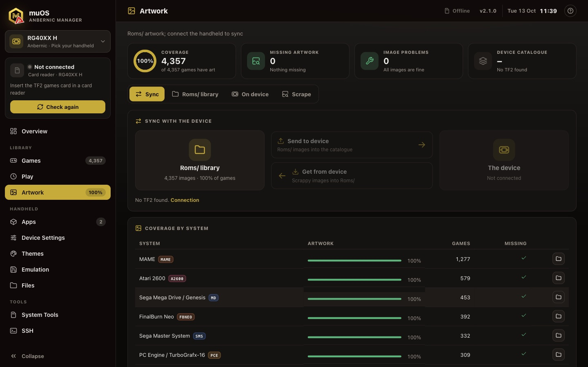
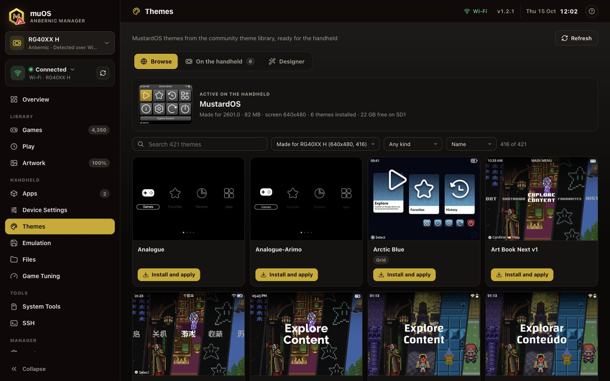
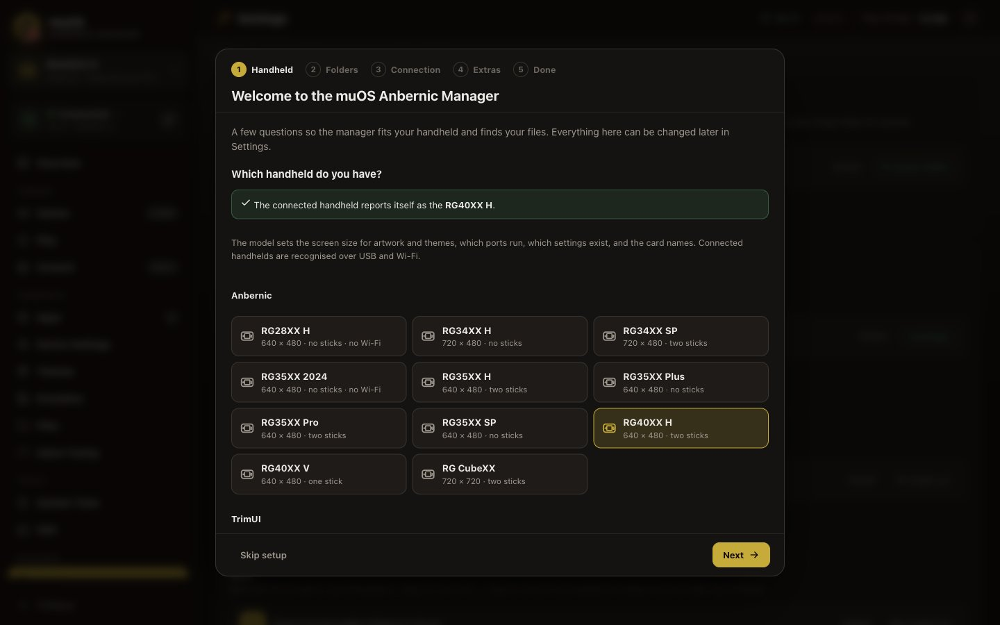

<div align="center">


# muOS Anbernic Manager

**Your games, artwork, apps, themes and handheld settings for MustardOS, managed from a browser tab on your computer.**

[](https://nodejs.org/)
[](#requirements)
[](https://muos.dev/)
[](LICENSE)



</div>

The manager runs on your Mac, Linux or Windows computer and looks after an Anbernic or TrimUI handheld running
[MustardOS (muOS)](https://muos.dev/). It keeps your `Roms/` library tidy with box art and descriptions, copies games to the
handheld over a card reader, USB or Wi-Fi, installs apps, themes and PortMaster ports, and changes the handheld's own settings,
without editing files by hand or remembering where MustardOS keeps things.

Everything happens locally: the manager is a small Node.js server with a web interface on `127.0.0.1`, protected by a
per-session token. Nothing is uploaded anywhere.

## Contents

- [Features](#features)
- [Screenshots](#screenshots)
- [Supported handhelds](#supported-handhelds)
- [Requirements](#requirements)
- [Installation](#installation): [macOS and Linux](#macos-and-linux), [Windows](#windows), [App shortcut](#app-shortcut)
- [Connecting the handheld](#connecting-the-handheld)
- [Usage](#usage)
- [Safety](#safety)
- [Troubleshooting](#troubleshooting)
- [Development](#development)
- [Changelog](CHANGELOG.md)
- [Credits](#credits)
- [License](#license)

## Features

**Library**
- **Games**: browse the whole `Roms/` library by system, with search, filters (artwork, genre, rating, year) and grid or list views.
  Add games by drag and drop, copy them to the handheld, see what is on the device and what is missing, and remove games.
- **Game view**: each game's box art, description, video and database facts, its library check and BIOS needs, and,
  with the handheld connected, whether it is on it, the core it starts with, play time, collections and saves. Related
  games (other versions, series, developer, genre) are one click away, and you can write your own description or drop
  in new artwork.
- **Artwork**: fetch box art, screenshots and descriptions for every game (libretro thumbnails, LaunchBox Games Database),
  in the size your handheld's screen needs, and sync them to the device.
- **Play**: play time, recently played games and collections from the handheld.
- **ScummVM and ports**: ScummVM games with their data folders, a list of classic adventures released for free with
  one-click download, and the PortMaster catalogue with install and uninstall over Wi-Fi.

**Handheld**
- **Apps**: an app market of popular MustardOS apps with screenshots and release notes, picking the package for your
  handheld; install `.muxapp` apps and `.muxupd` updates, and check for new MustardOS releases.
- **Device Settings**: change MustardOS settings (display, audio, network, interface and more) from the computer.
- **Themes**: browse the community theme library filtered for your screen, preview themes, install and apply them.
- **Emulation**: back up and restore saves and save states, check BIOS files, choose emulator cores per system or game,
  edit RetroArch options, and run a health check of your library. **Systems** lists every system with what the
  handheld can run, and why a system is missing when it cannot.
- **Files**: this computer and the handheld side by side; copy, rename, delete, preview and edit config files.
- **Game Tuning**: per-game emulator settings for heavy or light games (PPSSPP, Mupen64Plus-Next, PCSX-ReARMed,
  SwanStation, DuckStation, Flycast) and a per-game CPU governor, with Fastest, Balanced and Best looking presets and
  recommendations for known heavy games. Pick the system from a list you filter by typing.

**Tools**
- **System Tools**: install MustardOS on an SD card, set up a games card (TF2) with every system folder, or wipe a card.
- **SSH**: a terminal on the handheld in the browser, plus a quick look at its system.
- **Wiki**: built-in help for every page, a glossary and troubleshooting.
- **Updates**: the top bar shows when a new version is out, and **Update now** installs it with one click, whether you
  cloned the repository or downloaded the ZIP. See [CHANGELOG.md](CHANGELOG.md) for what changed in each version.
- **Settings**: folders, connections, caches, history resets and a factory reset that starts over from the setup wizard.

## Screenshots

<p align="center"></p>
<p align="center"><em>The game view: box art, description, rating and library check, the game's state on the handheld (core, play time, saves), and tabs for details, handheld data and related games.</em></p>

<p align="center"></p>
<p align="center"><em>Artwork: coverage per system, scraping what is missing, and syncing box art with the handheld.</em></p>

<p align="center"></p>
<p align="center"><em>Themes: the MustardOS community themes that fit your screen, ready to preview, install and apply.</em></p>

<p align="center"></p>
<p align="center"><em>Setup wizard: the first start asks for your handheld, folders and connection.</em></p>

## Supported handhelds

The manager follows the model it is talking to: screen size for artwork and themes, which ports run, which settings exist,
and whether there is a second card slot and Wi-Fi. Connected handhelds are recognised automatically over USB and Wi-Fi;
for a card in a card reader the manager asks once and remembers the answer.

| Maker | Models |
| --- | --- |
| Anbernic | RG28XX H, RG34XX H, RG34XX SP, RG35XX 2024, RG35XX H, RG35XX Plus, RG35XX Pro, RG35XX SP, RG40XX H, RG40XX V, RG CubeXX |
| TrimUI | Brick, Smart Pro |

## Requirements

- **Node.js 23.6 or newer** (the manager runs its TypeScript directly; there is no build step). The installer offers to
  install it with Homebrew on macOS and with winget on Windows.
- **macOS, Linux or Windows 10/11.** macOS and Linux use `installer.sh` and `run.sh`; Windows uses `installer.cmd` and
  `run.cmd` (PowerShell scripts that come with Windows).
- For **USB**: `libmtp` (`brew install libmtp` on macOS, `sudo apt install libmtp9` or similar on Linux, `libmtp-9.dll`
  on the `PATH` on Windows). The macOS installer offers it. The card reader and Wi-Fi work without it.
- For **Wi-Fi**: the handheld and computer on the same network.
- A modern browser (Chrome, Edge, Firefox or Safari).

## Installation

### macOS and Linux

1. Pick a folder for your handheld files and clone the repository into it. The manager puts its workspace (`Roms/`,
   `apps/`, `os/`, `bios/`, `backups/`) next to its own folder, so a dedicated folder keeps things together:

   ```bash
   mkdir -p ~/Handheld && cd ~/Handheld
   git clone https://github.com/aaronns87/muos-anbernic-manager.git
   ```

   No git? Download the ZIP from the green **Code** button and unpack it into that folder as `muos-anbernic-manager`.
   Both update themselves from inside the manager (see [Updates](#updates)); a clone also lets you update with `git pull`.

2. Run the installer:

   ```bash
   ./muos-anbernic-manager/installer.sh
   ```

   It checks Node.js and installs the npm packages, offers `libmtp` for USB, creates the workspace folders (with one folder
   per MustardOS system in `Roms/`), can start from a clean cache, and offers an [app shortcut](#app-shortcut). Existing
   folders and files are never touched. Options: `--workspace DIR` to put the workspace somewhere else, `--yes` to accept
   the defaults, `--help` for the rest.

3. The installer starts the manager and your browser opens the **setup wizard**: pick your handheld, check the folders,
   choose how to connect, and optionally download the game descriptions (about 110 MB). Skip anything; it is all in
   **Settings** later, and **Settings > Game data > Run setup** opens the wizard again.

4. Next time, open **muOS Anbernic Manager** from Applications or the app menu, or run:

   ```bash
   ./muos-anbernic-manager/run.sh
   ```

   Keep the terminal window open while you use it; closing it or pressing `Ctrl-C` stops the manager.

### Windows

1. Pick a folder for your handheld files, for example `C:\Users\<you>\Handheld`, and clone the repository into it from
   PowerShell or Command Prompt:

   ```powershell
   mkdir $HOME\Handheld; cd $HOME\Handheld
   git clone https://github.com/aaronns87/muos-anbernic-manager.git
   ```

   No git? Download the ZIP from the green **Code** button, unpack it into that folder and rename the result to
   `muos-anbernic-manager` (GitHub names it `muos-anbernic-manager-main`).

2. Double-click `installer.cmd` in the `muos-anbernic-manager` folder, or run it from a terminal:

   ```powershell
   .\muos-anbernic-manager\installer.cmd
   ```

   It does the same as the macOS and Linux installer: offers to install Node.js with winget if it is missing, installs the
   npm packages, creates the workspace folders, can start from a clean cache and offers a Start menu shortcut. It takes
   the same options (`--workspace DIR`, `--yes`, `--help`, ...).

3. The installer starts the manager and your browser opens the **setup wizard**, as above.

4. Next time, open **muOS Anbernic Manager** from the Start menu, or double-click `run.cmd`. Keep its window open while you
   use the manager; closing it stops the manager.

### App shortcut

The installers ask whether to add **muOS Anbernic Manager** with its icon to Applications (macOS, in `~/Applications`),
the Start menu (Windows) or the app menu (Linux). The setup wizard and **Settings > Transfers, startup and updates >
App shortcut** offer it too, and can create it again after you move the manager's folder. The shortcut opens a terminal
window that runs the manager and opens it in your browser, the same as `run.sh` or `run.cmd`; closing that window stops
the manager. From a terminal: `node muos-anbernic-manager/src/main.ts --shortcut`.

### Updates

The manager compares its `VERSION` file with the one on GitHub every few hours. When there is a newer version, the top
bar shows **Update** next to the clock (otherwise it shows the version you have). Click it, then **Update now**:

- **Cloned with git**: the manager runs `git pull` on the `main` branch. If you changed files in the manager folder or
  switched branches, it tells you what to do instead of pulling.
- **Downloaded as ZIP**: the manager downloads the ZIP of `main` from GitHub, checks it, and swaps in the new program
  files. The replaced files are kept in `muos-anbernic-manager/.update-old/` until the next update, and put back
  automatically if anything goes wrong.

Either way it installs new packages if needed and restarts in the same browser tab (when started with `run.sh`, `run.cmd`
or the app shortcut).
Your `Roms/`, workspace folders, settings and logins (`.cache/`) are never touched. From a terminal, a clone updates
with `git -C muos-anbernic-manager pull`, then `run.sh`.

The check only reads the version number from GitHub; turn it off under **Settings > Check for manager updates**.
**What's new** in the update dialog opens [CHANGELOG.md](CHANGELOG.md), which lists the changes in every version and
those already on `main` but not yet released.

## Connecting the handheld

| Connection | How | Good for |
| --- | --- | --- |
| Card reader | Take the games card (TF2, or the only card on one-slot models) out and put it in the computer. | Copying many games quickly; System Tools. |
| USB cable | On the handheld: **Configuration > Advanced Settings > USB Function > MTP**, then plug it in. | Copying games and artwork; play time. |
| Wi-Fi | Turn on **Configuration > Web Services > SFTP + Filebrowser** (files) and **Secure Shell** (everything else). | Everything, including apps, themes, ports, settings and saves. |

Switch between them at the top of the Overview page. The default MustardOS logins (`muos`/`muos` for SFTP, `root`/`root`
for SSH) are filled in; **Find on network** looks for the handheld's address.

## Usage

- **Add games**: drop ROM files on the Games page or use **Add games**. They go into the right `Roms/<SYSTEM>` folder with
  artwork and a description.
- **Copy to the handheld**: select games and use **Transfer**, or compare the library with the device on the Overview page.
- **Artwork**: the Artwork page shows what is missing; **Scrape** fetches it, sized for your screen.
- **Install MustardOS**: put a release image (`.img.gz`) in `os/` or download it from the Apps page, then use
  **System Tools** with the card in a card reader.

Every page has a **?** button that opens its Wiki article.

### Command-line options

```
./muos-anbernic-manager/run.sh [--no-open] [--port N] [--root DIR] [--skip-descriptions] [--refresh-descriptions]
```

On Windows, `run.cmd` takes the same options. `--root DIR` uses another workspace; `--port N` picks another port
(default 8765); `node src/main.ts --help` lists the rest.

## Safety

- Deleting something on the computer moves it to the **Trash**. Deleting on the handheld or its cards is **permanent**,
  and the manager says so before it does it.
- **Settings > Factory reset** asks you to type RESET, then moves the game library, the other workspace folders and the
  manager's cache to the Trash.
- Anything that changes the handheld or erases a card asks first and explains what will happen. System Tools only offers
  removable cards, never internal disks.
- Logins for Wi-Fi and SSH are stored in `muos-anbernic-manager/.cache/` on your computer only (file mode 600).
- The web interface listens on `127.0.0.1` only and needs the token from the URL the manager opens.

## Troubleshooting

- **"Node.js is too old"**: install Node.js 23.6 or newer from [nodejs.org](https://nodejs.org/) or with `brew install node`.
- **USB shows nothing on a Mac**: install `libmtp` (`brew install libmtp`), set the handheld's USB Function to MTP, and quit
  apps that grab MTP devices (Android File Transfer, OpenMTP).
- **The handheld is not found over USB, often after a restart**: unplug the cable, wait until the handheld has finished
  starting, and plug it in again; plugged in during start-up, its USB port can come up in the wrong mode. On a Mac, unlock
  it and click **Allow** on the accessory prompt (or check **System Settings > Privacy & Security > Allow accessories to
  connect**), and try another cable if it still shows nothing: charge-only cables carry no data.
- **Wi-Fi does not connect**: check that SFTP + Filebrowser is on and the address under Wi-Fi settings is right; features
  that change the handheld also need Secure Shell.
- **The card reader card is not found**: on one-slot models the games live on the only card; pick your model in the picker
  under the logo so the manager knows.
- **Start over**: `./muos-anbernic-manager/installer.sh --clean-cache` (or `installer.cmd --clean-cache` on Windows)
  moves the cache aside (Wi-Fi logins, downloads and settings) and shows the setup wizard on the next start. To also
  clear your games and the other workspace folders, use **Settings > Factory reset**: it moves everything to the Trash,
  creates empty folders and restarts into the setup wizard. The handheld is not touched.
- **Windows asks whether to run `installer.cmd` or `run.cmd`**: files from a downloaded ZIP carry a "from the internet"
  mark. Choose **More info > Run anyway**, or right-click the ZIP, open **Properties**, tick **Unblock** and unpack it again.
- **winget is missing on Windows**: install **App Installer** from the Microsoft Store, or install Node.js from
  [nodejs.org](https://nodejs.org/), then run `installer.cmd` again.
- **The app shortcut does nothing after moving the manager**: create it again under **Settings > Transfers, startup and
  updates > App shortcut**, or run the installer again.

The Wiki inside the manager has a longer Troubleshooting page.

## Development

```bash
npm install
npm test          # unit and server tests (node --test)
npm run check     # TypeScript type check
```

The server is in `src/` (TypeScript run directly by Node; entry point `src/main.ts`, routes in `src/server.ts`), and the
interface is plain ES modules in `public/` with no framework or bundler. Issues and pull requests are welcome; please run
the tests and type check first, and keep changes that write to the handheld behind an explicit user action.

- [CONTRIBUTING.md](CONTRIBUTING.md): setup, tests, pull requests and how versions are released.
- [CHANGELOG.md](CHANGELOG.md): release notes and version history; add user-visible changes under **Unreleased**.
- [docs/architecture.md](docs/architecture.md): module map, request flow, device access and the MustardOS paths used.
- [AGENTS.md](AGENTS.md): short guide for coding agents; Cursor also picks up the rules in `.cursor/rules/` and the
  task guides in `.cursor/skills/` (feature workflow, testing, device access, releasing).

## Credits

- [MustardOS](https://muos.dev/) and its community, for the firmware and the theme library.
- [PortMaster](https://portmaster.games/) for the ports catalogue.
- [libretro thumbnails](https://thumbnails.libretro.com/) and the [libretro database](https://github.com/libretro/libretro-database) for artwork and game names.
- [LaunchBox Games Database](https://gamesdb.launchbox-app.com/) for descriptions, genres and ratings.
- [ScummVM](https://www.scummvm.org/) and the authors who released their games for free.
- [xterm.js](https://xtermjs.org/), [ssh2](https://github.com/mscdex/ssh2), [koffi](https://koffi.dev/), [libmtp](https://libmtp.sourceforge.net/),
  [saxes](https://github.com/lddubeau/saxes) and [yauzl](https://github.com/thejoshwolfe/yauzl).

This project is not affiliated with MustardOS, Anbernic or TrimUI.

## License

Copyright (C) 2026 aaronns87

Licensed under the [GNU Affero General Public License v3.0 or later](LICENSE). You may use, study, change
and share the manager freely. If you distribute a modified version, or let others use one over a network,
you must publish its source code under the same license.
